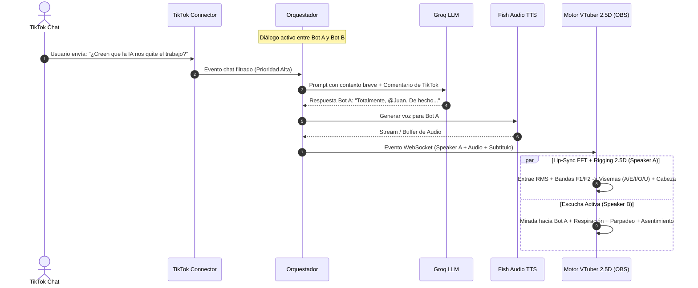

# Especificación y Arquitectura: Podcast Dual IA para TikTok Live (Edición VTuber 2.5D)
**Plataforma de Ejecución:** Entorno local / Antigravity  
**Hardware objetivo:** Intel Core i7, 24 GB RAM (Optimizado para bajo consumo de recursos, 0% GPU dedicada)  
**Meta de costes:** $0 en animación/lipsync (VTuber 2D/2.5D local), coste ultra bajo en inferencia (Groq) y voz (Fish Audio).

---

## 1. Visión General del Sistema

Un sistema autónomo de podcast en vivo con dos presentadores virtuales estilo **VTuber / 2D Rigging (Híbrido Live2D + Rig 2.5D)** interactuando entre sí mediante diálogo continuo, interrumpiendo o adaptando su conversación en tiempo real ante eventos de TikTok Live (nuevos espectadores, comentarios, regalos y likes).

```
                      ┌────────────────────────────────────────┐
                      │          CONECTOR TIKTOK LIVE          │
                      │     (Eventos: chat, join, gifts)       │
                      └──────────────────┬─────────────────────┘
                                         │ Eventos con prioridad
                                         ▼
┌──────────────────┐           ┌───────────────────┐          ┌──────────────────┐
│   CONFIGURACIÓN  │           │   ORQUESTADOR DE  │          │   GROQ API       │
│  - Prompts/Roles │ ◄───────► │   CONVERSACIÓN    │ ◄──────► │  (Llama 3 / 8B)  │
│  - Modelos 2D    │           │ (Cola y Turnos)   │          │  Bajo consumo    │
│  - Escenario     │           └─────────┬─────────┘          └──────────────────┘
└──────────────────┘                     │
                                         ▼
                               ┌───────────────────┐
                               │    FISH AUDIO     │
                               │  (TTS Streaming)  │
                               └─────────┬─────────┘
                                         │
                    ┌────────────────────┴────────────────────┐
                    ▼                                         ▼
         [Pista de Audio Local]                  [Motor VTuber 2.5D / OBS]
        Salida a altavoz / OBS               FFT Visemas (A/E/I/O/U) + Rigging 2D
```

---

## 2. Arquitectura de Módulos

### Módulo A: Configuración y Escenario (Panel de Control)
Permite configurar el podcast antes o durante la transmisión sin reiniciar la aplicación:

1. **Gestión de Personajes (A y B):**
   * **Nombre y Rol:** Ejemplo: *Alex (Crítico escéptico)* vs *Sofi (Optimista tecnológica)*.
   * **System Prompt:** Personalidad, tono de voz, nivel de humor y reglas de concisión (respuestas de 1 a 3 frases máximo para dinamismo).
   * **ID de Voz:** Modelo / Voice ID correspondiente en Fish Audio (con fallback a Web Speech API / tono sintético de prueba para desarrollo sin gastar créditos).
2. **Motor de Avatares Híbrido (Live2D Cubism + Rigging 2.5D Integrado):**
   * **Modo Live2D (`.model3.json` / `.moc3`):** Carga de modelos Live2D mediante PixiJS / Cubism Web SDK, inyectando en tiempo real los parámetros de rigging:
     * `ParamMouthOpenY` (apertura vertical según energía vocal).
     * `ParamMouthForm` (deformación de vocales/sonrisa según frecuencias FFT).
     * `ParamAngleX`, `ParamAngleY`, `ParamAngleZ` y `ParamBodyAngleX` (movimiento natural de cabeza y torso al hablar).
     * `ParamEyeLOpen`, `ParamEyeROpen` y `ParamBreath` (parpadeo y respiración autónoma).
   * **Modo Rig 2.5D Procedural / PNGTuber (Listo desde el Día 1):**
     * Avatares 2.5D integrados por capas articuladas (cabeza, cabello con física secundaria, ojos con seguimiento de mirada al interlocutor, cejas dinámicas, torso con respiración y boca paramétrica con visemas `SIL`, `A`, `E`, `I`, `O`, `U`).
     * Soporte opcional para sprites PNG personalizados (`idle_open`, `idle_blink`, `talk_half`, `talk_open`).
   * Coordenadas $(X, Y)$ y escala de cada personaje en el lienzo vertical ($1080 \times 1920$).
3. **Gestor de Temas (Topic Engine):**
   * **Tema Base:** Título y premisa del debate inicial (ej. "La IA reemplazará a los programadores").
   * **Analizador de Tendencias:** Prompt one-shot a Groq que sugiere 3 temas controversiales o de moda basados en una palabra clave o nicho.

---

### Módulo B: Conector TikTok Live (Event Listener)
Implementado mediante `tiktok-live-connector` en el backend (con simulador integrado en el panel para pruebas en local):

* **Eventos capturados:**
  * `member`: Usuario entra al live.
  * `chat`: Mensaje o pregunta de un usuario.
  * `gift`: Envío de rosas, cofres o regalos mayores.
  * `like`: Hitos de likes (ej. cada 500 likes acumulados).
* **Filtro de Ruido (Anti-Spam de Tokens):**
  * Para no colapsar la API ni saturar a los personajes, los eventos pasan por un **filtro de buffer**:
    * Ignorar saludos masivos continuos; agrupar entradas cada $N$ segundos ("¡Bienvenidos a todos los que van llegando, como @pedro y @laura!").
    * Filtro de comentarios relevantes: Descartar spam de un solo emoji; priorizar preguntas con signos de interrogación o palabras clave del tema.

---

### Módulo C: Orquestador Conversacional & Optimización de Tokens (Groq)

Para mantener los costos al mínimo absoluto y una latencia inferior a 500 ms:

* **Modelo recomendado:** `llama-3.1-8b-instant` en Groq (extremadamente económico y ultra rápido).
* **Gestor de Contexto (Rolling Memory):**
  * En lugar de enviar un historial largo que consuma miles de tokens por turno, mantener solo los **últimos 4 a 6 turnos de diálogo**.
  * Formato compacto en el prompt:
    ```text
    Contexto del debate: [TEMA]
    Público: [Último comentario/evento seleccionado de TikTok si existe]
    Alex: "..."
    Sofi: "..."
    Instrucción para Alex: Responde a Sofi o comenta la opinión del usuario en máximo 2 frases.
    ```
* **Sistema de Prioridad de Cola:**
  1. **Prioridad 1 (Regalos):** Interrumpe o se inserta inmediatamente en el siguiente turno con agradecimiento entusiasta.
  2. **Prioridad 2 (Pregunta relevante de usuario):** Se introduce en la conversación: *"Oye Sofi, mira lo que pregunta @carlos: dice que..."*
  3. **Prioridad 3 (Diálogo orgánico A ↔ B):** Continúan el debate estándar si el chat está tranquilo.

---

### Módulo D: Motor de Voz (Fish Audio + Fallback Demo)
* El texto generado por Groq se envía a Fish Audio API (`/v1/tts`).
* Genera audio en formato MP3/WAV y lo transmite al cliente como stream o buffer base64/URL local.
* Emite el evento por WebSocket `{ speaker: "A" | "B", text: "...", audioBase64: "..." }`.
* **Modo Demo / Sin API Key:** Si no se ha configurado aún la clave de Fish Audio, incluye un sintetizador vocal/formántico en navegador para probar de inmediato todo el rigging VTuber y el lip-sync sin coste.

---

### Módulo E: Renderizado VTuber 2.5D & Lip-Sync por Frecuencias/Visemas (0 Tokens, 0 GPU)
Implementado como una vista web local (HTML5 Canvas / PixiJS + Web Audio API) para incrustar en OBS como **Browser Source** (`?obs=true`):

1. **Análisis Espectral en Tiempo Real (Web Audio API `AnalyserNode`):**
   * **Amplitud (`mouthOpenY` $\in [0, 1]$):** Energía RMS con suavizado exponencial (attack rápido de 35 ms y release suave de 90 ms) para evitar parpadeos bruscos en la boca.
   * **Frecuencias y Formantes (`mouthForm` $\in [-1, 1]$ y Visemas `SIL, A, E, I, O, U`):**
     * **Banda Baja (100 – 450 Hz):** Energía fundamental y vocales cerradas/redondeadas (`U`, `O`).
     * **Banda Media / F1 (450 – 1300 Hz):** Dominante en vocales abiertas (`A`, `O`).
     * **Banda Alta / F2 (1300 – 3200 Hz):** Dominante en vocales frontales estiradas (`E`, `I`).
     * **Clasificador de Visemas:** Combina `mouthOpenY` y la relación espectral $F_2 / F_1$ para deformar la boca en tiempo real entre `SIL` (cerrada), `A` (abierta amplia), `E` (media estirada), `I` (cerrada estirada), `O` (abierta redonda) y `U` (pequeña redonda).
2. **Rigging Procedural y Vida Artificial (Idle / Escucha Activa):**
   * **Respiración continua:** Oscilación sinusoidal en torso y hombros ($\sim 0.25\text{ Hz}$).
   * **Parpadeo natural:** Temporizador estocástico (cada 2.5 a 4.8 s) con cierre suave de párpados.
   * **Física al hablar vs. escuchar:**
     * El personaje que habla inclina ligeramente cabeza y cejas al ritmo de la envolvente de voz (`headPitch`, `headRoll`, `browLift`).
     * El personaje que escucha dirige la mirada hacia el hablante y realiza micro-asentimientos periódicos.

---

## 3. Flujo Operativo Paso a Paso



---

## 4. Estructura del Proyecto

```text
Podcast/
├── backend/
│   ├── src/
│   │   ├── services/
│   │   │   ├── groqService.ts        # Llamadas a Llama 3.1 8B con memoria rodante
│   │   │   ├── fishAudioService.ts   # Conexión TTS a Fish Audio API
│   │   │   ├── tiktokService.ts      # Escucha de eventos de TikTok Live + Simulador
│   │   │   └── topicEngine.ts        # Sugeridor de temas virales con Groq
│   │   ├── orchestrator.ts           # Manejo de turnos, cola de prioridad y estado
│   │   ├── types.ts                  # Tipos compartidos del sistema
│   │   └── server.ts                 # Servidor Express + WebSocket (ws)
│   ├── package.json
│   └── tsconfig.json
│
├── frontend/                         # Panel de Control + Escenario VTuber 1080x1920
│   ├── src/
│   │   ├── components/
│   │   │   ├── ControlPanel.tsx      # Configuración de bots, prompts, temas y simulador TikTok
│   │   │   ├── StageManager.tsx      # Selector Live2D (.model3.json) / Rig 2.5D / Sprites
│   │   │   ├── LivePreview.tsx       # Lienzo vertical 9:16 (1080x1920) listo para OBS
│   │   │   └── VTuberAvatar.tsx      # Renderizador Híbrido (Rig 2.5D articulado + Live2D)
│   │   ├── hooks/
│   │   │   └── useAudioLipSync.ts    # Analizador FFT de bandas F1/F2, RMS y visemas A/E/I/O/U
│   │   ├── types.ts
│   │   ├── App.tsx
│   │   └── main.tsx
│   ├── package.json
│   └── vite.config.ts
│
└── arquitectura_podcast_ia_tiktok_live.md
```

---

## 5. Estrategias de Ahorro y Eficiencia

| Componente | Medida de Optimización | Impacto en Costo / Rendimiento |
| :--- | :--- | :--- |
| **Animación VTuber & Lip-Sync** | Rigging 2.5D / Live2D + Análisis FFT de formantes en Web Audio API local. | **$0 tokens / 0% GPU dedicada / <3% uso de CPU.** |
| **Inferencia de Texto** | Respuestas acotadas a 1-2 oraciones; modelo `llama-3.1-8b-instant` en Groq. | **Céntimos por horas de streaming continuo.** |
| **Memoria de Diálogo** | Ventana deslizante de solo los últimos 6 turnos en lugar de acumular historial. | **Evita crecimiento lineal de tokens.** |
| **TTS (Fish Audio)** | Generación por turno con modo demo local gratuito para pruebas de estudio. | **Consumo estrictamente limitado a palabras en vivo.** |
| **Eventos de TikTok** | Agrupación y filtro anti-spam con cola de prioridades (Regalos > Preguntas > Chat). | **Evita saturación de la API de Groq.** |
